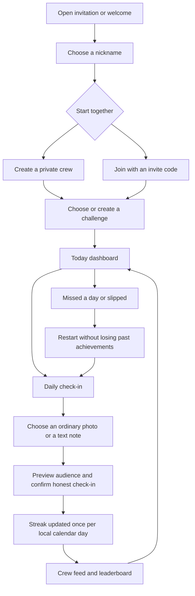

# LOCKED IN — visual prototype

A private, friendly accountability app for friends choosing an abstinence challenge. First delivery: a responsive, interactive PWA UI with local demo data, not live authentication or multi-user storage. The user explicitly delegated design decisions overnight.

## Journey drawn before implementation

## Visual direction

Cloud #f8f9fb, ink #242735, muted #707582, mint #c7eddf, lilac #e5dff9, peach #f8e2cf. Gradients confined to feature panels. Minecraft.ttf headings with a readable humanist sans body. Desktop left rail becomes a mobile bottom bar. Signature: an isometric seven-cell streak vault built with Anatomy geometry. The daily check-in is the primary action. No crowded notification systems.

## Screens and interactions

Today: personal streak, week calendar, check-in CTA, active challenge, recent crew check-ins. Crews: seeded crew plus locally created crews, detail view, member list and copyable demo invitation. Challenges: active and discover tabs, create form, join action, details and rules. Rankings: crew-scoped standings, current/best streak filters. Profile: name, achievements, local reminder preference, install instructions and restart confirmation. Welcome: illustrated login preview, nickname form, demo disclosure. Journey: user-facing visual map for reviewing the product.

## Trust and scope

Photos document showing up, never prove abstinence. No intimate photos requested. Photo selection stays on device in this prototype; preview and deletion supported. Text check-in is an equal alternative. No messages or invitations sent automatically. Login is explicitly a local preview. Crew members and activity are sample data; created records stay on this browser. Real authentication, invitation delivery, media storage, notifications, timezone authority and moderation are later backend work.

## Journey review using brainstorming and Web Interface Guidelines skills

- Entry: invitation context preserved in URL; demo invite clearly marked.
- First run: one nickname field; clear create/join actions.
- Daily loop: one primary action, preview before submit, same-day duplicate prevention.
- Recovery: calm restart action with confirmation, previous best retained.
- Privacy: audience shown before checking in; local-only photos disclosed.
- Accessibility: visible focus, native forms, named icon controls, accessible dialogs, reduced motion, 44px touch targets.
- Navigation: deep-linkable screens and mobile safe-area padding.
- Empty states: newly created crews offer invite/create-challenge next steps.
- Scope review: no claim of real authentication, real people, or proof; no medical claims.

## Anatomy figure concept and parts

Figure tier. A seven-slot mechanical streak vault: each completed day fills a token slot. 4 feet, 1 base, 1 bottom seal, 1 case, 1 lid, 4 corner fasteners, 2 side rails, 7 slot surrounds, 7 dark insets, 7 mint tokens, 7 token caps, 1 status panel, 1 status lamp, 1 engraved plate. 45 physical pieces. All positions derive from one seven-day progress value. No shaders or pipes required. User-controlled day selector for the login artwork; dashboard shows actual demo streak progress.

## User steering: Among Us influence and variations

Add three genuinely switchable directions and interactive journey previews in a Design Lab. Day Shift is a light mint/lilac crew-first flow; Night Shift is a dark orbital mission-first flow; Lobby Club is a peach/lime ritual-first flow. Borrow lobby, crew colors, daily tasks, ready states and round results. Use original space-crew avatars, not copied game assets. No deception mechanic or peer accusations about sexual behavior. Journey previews show each step visually, with forward/back controls and launch into the relevant real prototype screen.

## Final interaction-design review

Applied `npx ui-skills get interaction-design` after the first browser walkthrough. Feedback is immediate: preview before check-in, a persistent success view, saved nickname and creation confirmations, and a clear next action after creating a crew. Focus returns to the opening button when dialogs close. The daily loop has both photo and text paths. All journey previews have forward, back and direct step controls; visitors can change direction without losing their local demo records. Night Shift prioritizes missions; Lobby Club prioritizes the daily ritual; Day Shift leads with progress. DOM order matches each visual order.

Remaining deliberate prototype boundaries: nickname login is not authentication; invite links do not create cross-device memberships; leaderboard companions are samples; notifications and media storage are not connected. No journey claims that a photo proves abstinence. Production work needs private membership enforcement, independent challenge scoring, authoritative timezone handling, storage/deletion rules, invitation delivery and notification permissions.
